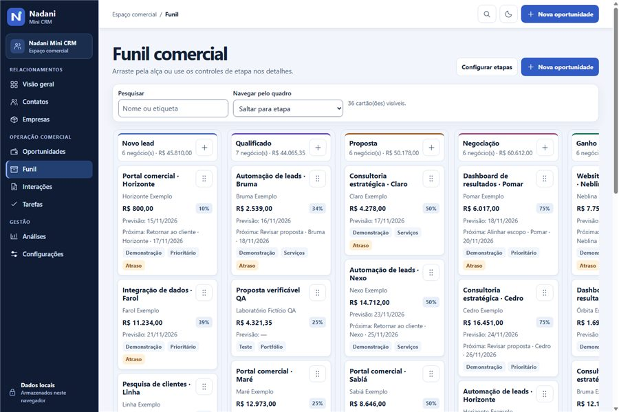

# 

[Nadani website](https://nadani.space) · [Featured projects](#featured-projects) · [Português](README.pt-BR.md)

## About me

I'm Nathan Marques (Nat), a Brazilian web developer and the creator of Nadani Productions. I build websites, productivity tools and custom web applications, with an interest in automating repetitive work and making business data easier to use.

## What I do

- **Web development** · Responsive landing pages, business websites and interactive web applications.
- **Business applications** · Dashboards, task management, sales workflows and tools for managing records.
- **Automation and data processing** · JavaScript scripts, file processing and workflows for cleaning or organizing CSV and Excel data.
- **Software improvements** · Bug fixes, new features, interface refinements and code maintenance within the agreed scope.

## Technologies & tools

- **Core technologies** · JavaScript and HTML5.
- **Complementary skills** · CSS3 and basic Python.
- **In these projects** · DOM APIs, responsive layouts, LocalStorage, IndexedDB, CSV and Excel processing, PDF generation and SVG charts. I use Node.js for local development servers and automated tests.
- **Tools** · Git, GitHub, Visual Studio Code.

## Featured Projects

Six independent portfolio projects using fictional or sample data.

### Nadani Mini CRM

Contact and company records, a drag-and-drop sales pipeline, follow-up tasks, and sales forecasts.

*JavaScript · IndexedDB · SVG*

[Source](https://github.com/4natx/nadani-mini-crm) · [Live demo](https://4natx.github.io/nadani-mini-crm/) · [Screenshot](assets/projects/mini-crm.jpg)

### Nadani Admin Dashboard

Tracks stock movements, customer records and sales, with interactive reports for a fictional business.

*JavaScript · IndexedDB · SVG*

[Source](https://github.com/4natx/nadani-admin-dashboard) · [Live demo](https://4natx.github.io/nadani-admin-dashboard/) · [Screenshot](assets/projects/admin-dashboard.jpg)

### Nadani Quote Generator

Builds quotes from a service catalog, calculates totals and exports branded PDF proposals from customizable templates.

*JavaScript · IndexedDB · Web Worker · PDF*

[Source](https://github.com/4natx/nadani-quote-generator) · [Live demo](https://4natx.github.io/nadani-quote-generator/) · [Screenshot](assets/projects/quote-generator.jpg)

### Nadani Data Tools

Cleans, validates, transforms and exports CSV and Excel data directly in the browser.

*JavaScript · Web Worker · Papa Parse · SheetJS*

[Source](https://github.com/4natx/nadani-data-tools) · [Live demo](https://4natx.github.io/nadani-data-tools/) · [Screenshot](assets/projects/data-tools.jpg)

### Nadani Task Manager

Organizes work in a Kanban board with drag-and-drop reordering, combined filters, progress charts and local storage.

*JavaScript · Pointer Events · LocalStorage*

[Source](https://github.com/4natx/nadani-task-manager) · [Live demo](https://4natx.github.io/nadani-task-manager/) · [Screenshot](assets/projects/task-manager.jpg)

### Nadani Business Landing

Responsive site for a fictional pet studio, with an interactive gallery and a clearly marked demo booking form.

*HTML5 · CSS Grid · JavaScript · SVG*

[Source](https://github.com/4natx/nadani-business-landing) · [Live demo](https://4natx.github.io/nadani-business-landing/) · [Screenshot](assets/projects/business-landing.jpg)

## Nadani Productions

Nadani Productions is my independent software development brand. It brings together the websites, tools and experiments I build, along with my freelance services.

## Let's work together

I'm available for freelance projects involving websites, JavaScript features, automation, dashboards and improvements to existing applications. If you have a project in mind, [tell me what you need](https://www.nadani.space/contact).

[Nadani website](https://nadani.space) · [GitHub](https://github.com/4natx)

---

Nathan Marques · Nadani Productions
