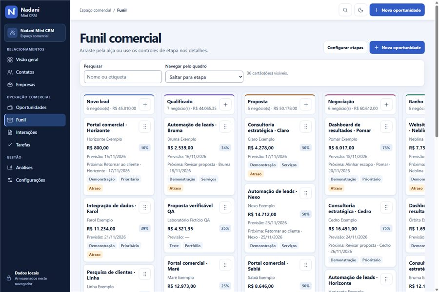

# 

[Site da Nadani](https://nadani.space) · [Projetos em destaque](#projetos-em-destaque) · [English](README.md)

## Sobre mim

Sou Nathan Marques (Nat), desenvolvedor web brasileiro e criador da Nadani Productions. Desenvolvo sites, ferramentas de produtividade e aplicações web personalizadas. Tenho interesse em automatizar tarefas repetitivas e facilitar o uso de dados no dia a dia de um negócio.

Uso IA para explorar abordagens, agilizar a implementação e revisar código. Testo o funcionamento da aplicação e organizo o código para facilitar a manutenção e a adaptação a outros projetos.

## O que desenvolvo

- **Desenvolvimento web** · Landing pages responsivas, sites institucionais e aplicações web interativas.
- **Aplicações empresariais** · Painéis, gerenciamento de tarefas, fluxos comerciais e ferramentas de cadastro.
- **Automação e processamento de dados** · Scripts em JavaScript, processamento de arquivos e fluxos de limpeza e organização de dados em CSV e Excel.
- **Melhorias em sistemas** · Correção de bugs, novas funcionalidades, ajustes de interface e manutenção de código dentro do escopo combinado.

## Tecnologias e ferramentas

- **Tecnologias principais** · JavaScript e HTML5.
- **Conhecimentos complementares** · CSS3, com apoio de IA na construção de interfaces, e conhecimentos básicos de Python.
- **Nestes projetos** · APIs do DOM, layouts responsivos, LocalStorage, IndexedDB, processamento de CSV e Excel, geração de PDF e gráficos SVG. Uso Node.js para os servidores locais e os testes automatizados.
- **Ferramentas** · Git, GitHub, Visual Studio Code, Codex e ChatGPT.

## Projetos em destaque

Seis demonstrações independentes de portfólio, com dados fictícios ou de exemplo.

### Nadani Mini CRM

Cadastro de contatos e empresas, funil com arraste de cartões, tarefas de acompanhamento e previsão de vendas.

*JavaScript · IndexedDB · SVG*

[Código](https://github.com/4natx/nadani-mini-crm) · [Demonstração](https://4natx.github.io/nadani-mini-crm/) · [Captura de tela](assets/projects/mini-crm.jpg)

### Nadani Admin Dashboard

Acompanha movimentações de estoque, cadastros de clientes e vendas, com relatórios interativos para uma empresa fictícia.

*JavaScript · IndexedDB · SVG*

[Código](https://github.com/4natx/nadani-admin-dashboard) · [Demonstração](https://4natx.github.io/nadani-admin-dashboard/) · [Captura de tela](assets/projects/admin-dashboard.jpg)

### Nadani Quote Generator

Monta orçamentos a partir de um catálogo, calcula os totais e exporta propostas em PDF com modelos personalizáveis.

*JavaScript · IndexedDB · Web Worker · PDF*

[Código](https://github.com/4natx/nadani-quote-generator) · [Demonstração](https://4natx.github.io/nadani-quote-generator/) · [Captura de tela](assets/projects/quote-generator.jpg)

### Nadani Data Tools

Limpa, valida, transforma e exporta dados de CSV e Excel diretamente no navegador.

*JavaScript · Web Worker · Papa Parse · SheetJS*

[Código](https://github.com/4natx/nadani-data-tools) · [Demonstração](https://4natx.github.io/nadani-data-tools/) · [Captura de tela](assets/projects/data-tools.jpg)

### Nadani Task Manager

Organiza o trabalho em um Kanban com reordenação por arraste, filtros combinados, gráficos de progresso e armazenamento local.

*JavaScript · Pointer Events · LocalStorage*

[Código](https://github.com/4natx/nadani-task-manager) · [Demonstração](https://4natx.github.io/nadani-task-manager/) · [Captura de tela](assets/projects/task-manager.jpg)

### Nadani Business Landing

Site responsivo de um estúdio pet fictício, com galeria interativa e formulário de agendamento demonstrativo identificado.

*HTML5 · CSS Grid · JavaScript · SVG*

[Código](https://github.com/4natx/nadani-business-landing) · [Demonstração](https://4natx.github.io/nadani-business-landing/) · [Captura de tela](assets/projects/business-landing.jpg)

## Nadani Productions

A Nadani Productions é minha marca independente de desenvolvimento de software. Ela reúne os sites, as ferramentas e os experimentos que construo, além dos serviços que ofereço como freelancer.

## Vamos trabalhar juntos

Estou disponível para projetos freelancer de desenvolvimento web, funcionalidades em JavaScript, automações, painéis e melhorias em aplicações existentes. Se você tem um projeto em mente, [conte o que precisa](https://www.nadani.space/contact).

[Site da Nadani](https://nadani.space) · [GitHub](https://github.com/4natx)

---

Nathan Marques · Nadani Productions
